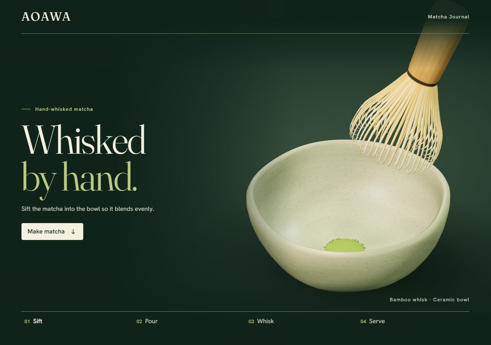
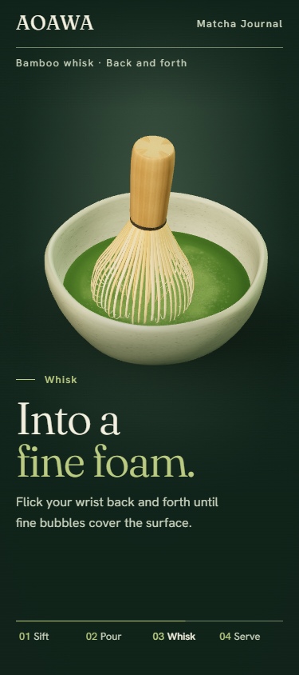
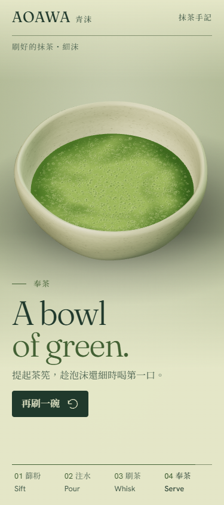
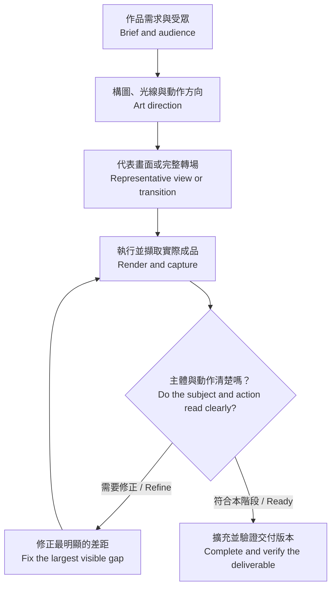

# Fable Design

**從作品需求出發，打磨構圖、材質、動作和互動。** 這是一個可手動啟用的 Codex 技能，適用於網頁、影片、螢幕錄影和獨立 3D 模型。

**A craft workflow for composition, materials, motion, and interaction.** Fable Design is an explicitly invoked Codex skill for websites, films, screen recordings, and standalone 3D models.

原創示範 **青沫 AOAWA · Whisked by Hand** 將篩粉、注水、刷出細沫和奉茶做成可逆的捲動敘事。下圖擷取自實際執行的 Three.js 網頁。

The original **AOAWA · Whisked by Hand** example follows sifting, pouring, whisking and serving on a reversible scroll timeline. The screenshots show the running Three.js site.

[開啟青沫抹茶互動示範 · Open the AOAWA matcha demo](https://ncusspm25.github.io/fable-design-public/)

[](docs/screenshots/desktop-opening.png)

| 刷茶 · Whisk | 奉茶 · Serve |
| :---: | :---: |
| [](docs/screenshots/mobile-whisk.png) | [](docs/screenshots/mobile-serve.png) |

## 製作流程 · Workflow

先用一個代表畫面或完整轉場驗證方向。把可見的問題修好後，再擴充整段體驗，最後在實際輸出中檢查。

Prove the direction with one representative view or complete transition. Correct visible weaknesses, extend the experience, then inspect the real deliverable.



## 使用技能 · Use the skill

將 `SKILL.md` 和 `agents/`、`references/`、`scripts/`、`templates/` 放在 Codex 的 `fable-design/` 技能資料夾。輸入 `/fable-design` 或 `$fable-design`，並附上你想完成的作品。可以從原創需求開始，也可以附參考。

Place `SKILL.md` and `agents/`, `references/`, `scripts/`, and `templates/` in a `fable-design/` skill directory for Codex. Invoke `/fable-design` or `$fable-design` with the deliverable you want. Start with an original brief or include references when useful.

```text
/fable-design 做一個手刷抹茶的互動網頁，先驗證茶筅刷出細沫的段落。
$fable-design Build an interactive matcha story. Prove the whisk-to-foam transition first.
```

## 執行示範 · Run the example

使用 Node.js 22 以上。在專案根目錄執行下列指令，開啟 [本機示範](http://127.0.0.1:4182)。

Use Node.js 22 or later. Run these commands from the repository root and open the [local demo](http://127.0.0.1:4182).

```sh
cd examples/hand-whisked-matcha
npm ci --ignore-scripts
npm start
```

下方章節可以直接跳轉。向上捲動可倒回動作，開啟系統的減少動態效果時會顯示章節定格。瀏覽器無法使用 WebGL 時，也可用圖片和文字瀏覽每一章。

The chapter rail supports direct navigation. Scroll up to reverse the action. Reduced motion uses stable chapter views, and a still-image fallback keeps the story readable without WebGL.

## 驗證工具 · Verification harness

- [事件表 · Event ledger](examples/hand-whisked-matcha/events.json) 同時提供畫面進度、章節和擷取點。The browser and capture script read the same progress markers.
- [事件表格式與抽幀 · Ledger format and video extraction](references/event-ledger.md) 提供 Node.js 驗證、Playwright 取景和 FFmpeg 抽幀。It documents validation, Playwright sampling, and FFmpeg frame extraction.
- 在示範目錄執行 `npm test` 和 `npm run capture -- <output-directory>`。使用 Playwright 已有的 Chromium 或以 `AOAWA_CHROMIUM` 指定執行檔。Run these from the example directory using an existing Playwright Chromium or the `AOAWA_CHROMIUM` executable.

### 成品檢查 · Visual review

| 觀察 · Observation | 修正 · Refinement |
| --- | --- |
| 茶筅太像金屬打蛋器，茶碗紋路太強，細沫不夠清楚。 / The whisk read as a wire whisk, the bowl texture was too strong, and the foam was faint. | 重塑竹絲的輪廓與材質，降低釉面紋理，讓細泡有可見的邊緣。 / Reshaped and recolored the bamboo tines, softened the glaze texture, and clarified bubble edges. |
| 手機段落斷行不自然，平板場景太高，碗身有一條可見接縫。 / Mobile line breaks were awkward, the tablet art was too tall, and a bowl seam was visible. | 簡化文案、重排平板場景並連續化碗身的法線。 / Shortened the copy, reframed the tablet stage, and smoothed the bowl normals across the seam. |

最新示範讓水柱垂直落在壺嘴正下方，漣漪沿落點擴散。茶筅在碗內來回刷動，刷完抬過碗口再退場。

In the current demo, water falls directly below the spout and ripples spread from the landing point. The whisk sweeps inside the bowl and lifts over the rim before leaving.

截圖來自 Chromium 的 375×844、768×900 和 1280×900 視窗。捲動與回捲、鍵盤和觸控章節導覽、減少動態與 WebGL 備援的 3 項測試均通過。[查看所有截圖](docs/screenshots/)

Chromium captures cover 375×844, 768×900, and 1280×900. Three browser tests passed for scrolling and reversal, keyboard and touch navigation, reduced motion, and WebGL fallback. [Browse the screenshots](docs/screenshots/)

## 素材與來源 · Assets and sources

茶碗、茶筅、篩網、細口壺、茶粉與泡沫都由程式生成。製茶動作參考一保堂的薄茶流程和日本傳統工藝的茶筅資料。[一保堂薄茶](https://global.ippodo-tea.co.jp/blogs/tea-recipe/basic-usucha-matcha) · [高山茶筅](https://japan-sui-collection.go.jp/en/collection/takayamachasenteawhisk/)

The bowl, whisk, sieve, kettle, powder, and foam are procedurally authored. The preparation sequence and whisk construction draw on primary references. [Ippodo usucha](https://global.ippodo-tea.co.jp/blogs/tea-recipe/basic-usucha-matcha) · [Takayama chasen](https://japan-sui-collection.go.jp/en/collection/takayamachasenteawhisk/)

字體由網站自身提供，並附 OFL 授權。[Fraunces](examples/hand-whisked-matcha/assets/OFL-Fraunces.txt) · [Hanken Grotesk](examples/hand-whisked-matcha/assets/OFL-Hanken-Grotesk.txt) · [Noto Serif TC](examples/hand-whisked-matcha/assets/OFL-Noto-Serif-TC.txt)

The site serves its own fonts and includes their OFL notices. [Fraunces](examples/hand-whisked-matcha/assets/OFL-Fraunces.txt) · [Hanken Grotesk](examples/hand-whisked-matcha/assets/OFL-Hanken-Grotesk.txt) · [Noto Serif TC](examples/hand-whisked-matcha/assets/OFL-Noto-Serif-TC.txt)
