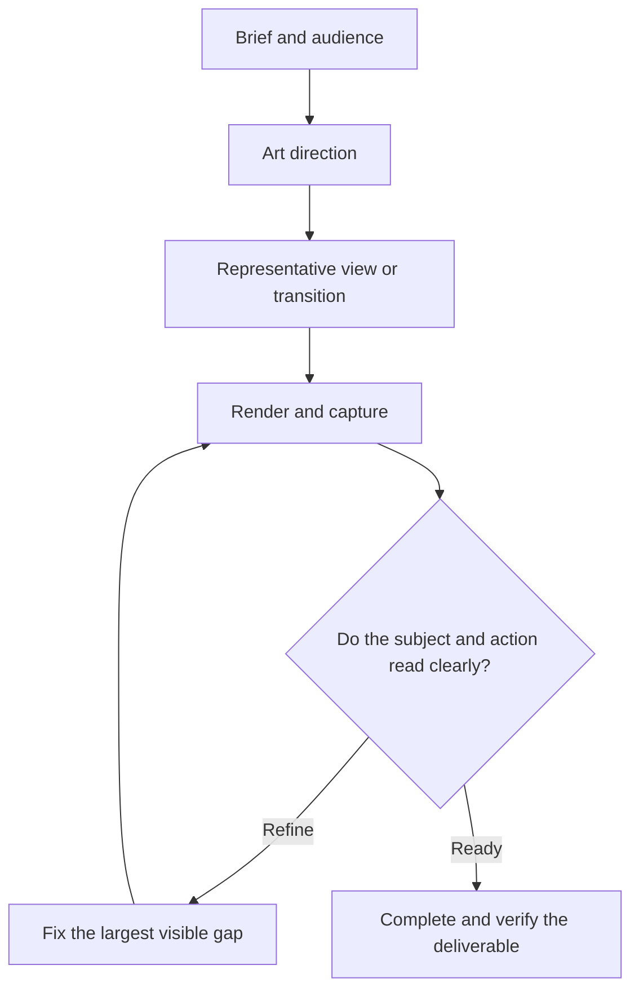

# Fable Design

**A craft workflow for composition, materials, motion, and interaction.** Fable Design is an explicitly invoked Codex skill for websites, films, screen recordings, and standalone 3D models.

The original **AOAWA · Whisked by Hand** example follows sifting, pouring, whisking and serving on a reversible scroll timeline. The screenshots show the running Three.js site.

[Open the AOAWA matcha demo](https://ncusspm25.github.io/fable-design-public/)

[](docs/screenshots/desktop-opening.png)

| Whisk | Serve |
| :---: | :---: |
| [](docs/screenshots/mobile-whisk.png) | [](docs/screenshots/mobile-serve.png) |

## Workflow

Prove the direction with one representative view or complete transition. Correct visible weaknesses, extend the experience, then inspect the real deliverable.



## Use the skill

Place `SKILL.md` and `agents/`, `references/`, `scripts/`, and `templates/` in a `fable-design/` skill directory for Codex. Invoke `/fable-design` or `$fable-design` with the deliverable you want. Start with an original brief or include references when useful.

```text
$fable-design Build an interactive matcha story. Prove the whisk-to-foam transition first.
```

## Run the example

Use Node.js 22 or later. Run these commands from the repository root and open the [local demo](http://127.0.0.1:4182).

```sh
cd examples/hand-whisked-matcha
npm ci --ignore-scripts
npm start
```

The chapter rail supports direct navigation. Scroll up to reverse the action. Reduced motion uses stable chapter views, and a still-image fallback keeps the story readable without WebGL.

## Verification harness

- [Event ledger](examples/hand-whisked-matcha/events.json) defines shared progress markers for the browser and the capture script.
- [Ledger format and frame extraction](references/event-ledger.md) documents Node.js validation, Playwright sampling, and FFmpeg extraction.
- In the example directory, run `npm test` and `npm run capture -- <output-directory>`. Use Playwright Chromium or set `AOAWA_CHROMIUM` to a Chromium executable.

### Visual review

| Observation | Refinement |
| --- | --- |
| The whisk read as a wire whisk, the bowl texture was too strong, and the foam was faint. | Reshaped and recolored the bamboo tines, softened the glaze texture, and clarified bubble edges. |
| Mobile line breaks were awkward, the tablet art was too tall, and a bowl seam was visible. | Shortened the copy, reframed the tablet stage, and smoothed the bowl normals across the seam. |

In the current demo, water falls directly below the spout and ripples spread from the landing point. The whisk sweeps inside the bowl and lifts over the rim before leaving.

Chromium captures cover 375×844, 768×900, and 1280×900. Three browser tests passed for scrolling and reversal, keyboard and touch navigation, reduced motion, and WebGL fallback. [Browse the screenshots](docs/screenshots/)

## Assets and sources

The bowl, whisk, sieve, kettle, powder, and foam are procedurally authored. The preparation sequence and whisk construction draw on primary references. [Ippodo usucha](https://global.ippodo-tea.co.jp/blogs/tea-recipe/basic-usucha-matcha) · [Takayama chasen](https://japan-sui-collection.go.jp/en/collection/takayamachasenteawhisk/)

The site serves its own fonts and includes their OFL notices. [Fraunces](examples/hand-whisked-matcha/assets/OFL-Fraunces.txt) · [Hanken Grotesk](examples/hand-whisked-matcha/assets/OFL-Hanken-Grotesk.txt)
